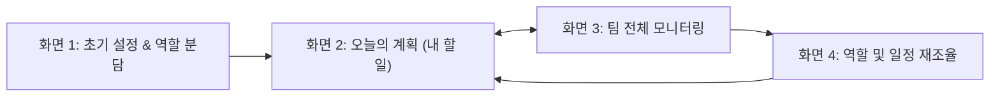

# 📋 팀핏 (TeamFit) 앱 개발 종합 계획서

> **"대학생 팀 프로젝트의 역할 분담 갈등을 덜고, 투명한 업무 기록과 일정 재조율을 돕는 모바일 웹앱"**

---

## 1. 프로젝트 개요

- **앱 명칭**: 팀핏 (TeamFit)
- **주요 타깃**: 팀 프로젝트를 수행하는 대학생 (예: 회계세무학과 2학년 등 대학생 팀플러)
- **핵심 목표**: 
  1. 감정 상하지 않는 공정하고 투명한 **역할 자동 분담**
  2. 팀원별/전체 진행률의 **실시간 시각화 및 모니터링**
  3. 미완료 업무의 **자동 이월 및 즉각적인 업무량 재조율**

---

## 2. 인터뷰 및 요구조사 반영 결정 사항

| 구분 | 결정 내용 | 상세 설명 |
| :--- | :--- | :--- |
| **기술 스택** | **React + Vite + Tailwind CSS** | 빠른 반응성, 트렌디한 모바일 UI 컴포넌트, PWA 확장성 제공 |
| **UI/UX 테마** | **대학생 맞춤 토스 모던 미니멀 + 귀여운 마스코트 핏티(Fitty)** | 시원한 화이트/소프트 그레이 베이스, 모던 세그먼트 컨트롤러(`[미시작|진행중|완료]`), 팀원별 동물 아바타(`🐰`, `🐻`, `🐱`), 진행률에 따라 반응하는 마스코트 캐릭터 |
| **분담 알고리즘** | **역할 선호 매칭 + 점수 균등 배분** | 난이도(A:3점, B:2점, C:1점) 총합이 팀원별로 최대한 균등해지도록 자동 분배 |
| **퀵 링크 편의** | **외부 협업 퀵버튼 연동** | [카톡 단톡방 & 참여코드 원클릭 복사], [구글 드라이브] 바로가기 지원 |
| **데이터 영속성** | **브라우저 LocalStorage** | 별도 백엔드/로그인 없이 브라우저에 모든 설정 및 진행 데이터 안전하게 저장 |
| **테스트 편의** | **시뮬레이터 툴바 탑재** | [다음 날로 이동(D+1)], [데이터 초기화] 버튼 상시 제공으로 룰 검증 용이 |

---

## 3. 핵심 기능 명세

### ① 스마트 초안 생성 (자동 역할 분담)
- **입력 데이터**:
  - 프로젝트 기본 정보 (프로젝트명, 마감일, 카카오톡/드라이브 링크)
  - 팀원 정보 (이름, 선호 역할: 자료조사, PPT 제작, 발표, 보고서 작성, 일정관리 등)
  - 업무(Task) 목록 및 난이도:
    - **A등급 (3점)**: 3시간 이상 소요되는 고난이도 업무
    - **B등급 (2점)**: 2시간 ~ 3시간 소요되는 중간 난이도 업무
    - **C등급 (1점)**: 1시간 이하 소요되는 단순/보조 업무
- **배분 로직**:
  - 팀원의 선호 역할을 우선 고려하여 1차 매칭
  - 팀원별 배정된 업무의 난이도 총점이 최대한 오차 1점 이내로 균등해지도록 최적 분배
  - 분담표 완료 시 팀원별 고유 파스텔 컬러가 부여된 카드 형태로 출력

### ② 일일 실행 기록 & 마이크로 액션
- **오늘 할 일(Today's Tasks)** 확인
- 상태 변경 버튼: `[미시작]` ➔ `[진행 중]` ➔ `[완료]` 3단계 원클릭 토글
- **진행 중 세부 진행도(%) 제어**:
  - `진행 중` 선택 시 실시간 미니 프로그레스 바와 함께 `[25%]`, `[50%]`, `[75%]` 퀵 버튼 및 정밀 조절 슬라이더 제공
  - 진행도 변경 시 개인 진행률 및 팀 전체 진행률(%)에 실시간 반영되어 얼마나 진행되었는지 즉각 파악 가능
- 업무 완료 시 즉시 전체 진행률과 개인 진행률에 실시간 반영

### ③ 실시간 모니터링 대시보드
- **팀 전체 진행률(%)**: 시각적 프로그레스 바 및 남은 업무 개수(분량) 요약
- **팀원별 상태 카드**:
  - 팀원별 담당 업무 목록, 완료율(%) 요약
  - 완료 업무 50% 이상 달성 시 초록색 축하 뱃지 및 프로그레스 강조

### ④ 스마트 일정 & 역할 재조율
- **미완료 업무 자동 이월**:
  - 마감일 경과 또는 미완료 체크 시 익일(다음 날) 할 일 목록 최상단에 `[이월됨]` 뱃지와 함께 자동 배치
- **업무 불균형 감지 시스템**:
  - 특정 팀원의 잔여 난이도 점수가 타 팀원 평균보다 **3점(A등급 1개 상당) 이상** 높아질 경우 대시보드 상단에 경고 배너 출력
  - `[담당자 재배정]` 버튼을 통해 여유 있는 팀원에게 업무를 간편하게 이양

---

## 4. 화면별 상세 설계 및 인터랙션

### [화면 1] 초기 설정 및 업무 입력
- **구성 요소**:
  - 프로젝트명 & 마감일자 선택기
  - 외부 협업 도구 입력 필드 (카톡방 링크, 공유 드라이브 링크)
  - 팀원 추가 폼 (이름, 선호 역할 태그 선택)
  - 과제 업무 리스트 입력 폼 (업무명, 마감일, 난이도 A/B/C 버튼)
- **주요 액션**:
  - `[역할 분담표 만들기]` 클릭 ➔ 균등 분배 알고리즘 실행 ➔ 결과 미리보기 팝업 ➔ 승인 시 화면 2(또는 메인 대시보드)로 이동

### [화면 2] 오늘의 계획 (Personal View)
- **구성 요소**:
  - 상단 퀵 네비게이션: [내 할 일 모아보기] / [팀 전체 보기] 탭
  - 헤더 퀵링크: [💬 카톡방 열기], [📁 과제 드라이브 열기]
  - 오늘의 나의 업무 리스트 카드
  - 각 업무별 상태 토글 버튼 (`미시작`, `진행 중`, `완료`)
- **주요 액션**:
  - 상태 변경 클릭 ➔ 로컬스토리지 저장 ➔ 화면 상단 달성률 게이지 즉각 업데이트
  - 상단 탭 클릭 ➔ 화면 3(팀 전체 모니터링)으로 전환

### [화면 3] 일일 시행 기록 및 팀 모니터링 (Team View)
- **구성 요소**:
  - 상단 종합 현황 카드: 전체 진행률(%), 남은 업무 분량(개수) 요약
  - 팀원별 섹션 카드 (이름, 선호 역할, 컬러 뱃지, 개별 달성률)
  - 팀원별 담당 세부 과업 리스트 (완료 여부 체크박스)
- **주요 액션**:
  - 각 팀원의 업무 상태를 한눈에 모니터링
  - 특정 업무의 `[미완료 이월]` 또는 `[재조율 필요]` 상태 확인 시 화면 4로 이동 버튼 제공

### [화면 4] 역할 및 일정 재조율 알림 (Rebalancing)
- **구성 요소**:
  - 불균형 감지 배너: "⚠️ [OOO] 팀원에게 업무가 과도하게 집중되어 있습니다 (평균 대비 +4점)"
  - 당일 미완료 및 이월 업무 목록
  - 팀원별 잔여 부하량(난이도 합계) 비교 차트/게이지
  - 업무별 드롭다운: 변경할 새 담당자 지정
- **주요 액션**:
  - `[다음 날 일정에 합산 반영]`: 이월 확정 및 목표 일정 재계산
  - `[담당자 변경 저장]`: 선택한 팀원에게 업무 이양 후 화면 2/3으로 복귀

---

## 5. 테스트 시뮬레이션 및 편의 도구

앱 화면 하단(또는 플로팅 독)에 항상 고정되는 **개발/시연용 시뮬레이션 툴바**를 구현합니다.
- **[☀️ D+1 다음 날로 진행]**: 
  - 현재 날짜가 1일 경과한 것으로 시뮬레이션
  - 미완료된 업무들을 자동으로 이월 목록에 등록하고 4번 재조율 트리거 작동
- **[🔄 처음부터 다시 (Reset)]**:
  - 저장된 로컬스토리지 데이터를 초기화하고 1번 화면으로 복귀
- **[✨ 샘플 데이터 채우기]**:
  - 시연 및 테스트를 위해 대학생 경영/회계 팀플(자료조사, 발표, PPT 등) 예시 데이터를 1초 만에 자동 완성

---

## 6. 기술 아키텍처 및 구현 스택

- **Frontend Core**: React 18+ (SPA), Vite
- **Styling**: Tailwind CSS (토스/노션 스타일 모던 미니멀 UI, 모바일 프레임 컨테이너)
- **Icons**: Lucide React
- **State & Storage**: React Hook + LocalStorage Persistence Layer
- **Layout**: 모바일 디바이스 최적화 뷰포트 (최대 480px 중앙 정렬 반응형 컨테이너)

---

## 7. 향후 개발 단계 (Roadmap)

1. **Phase 1: 프로젝트 세팅 및 레이아웃 기초**
   - React + Vite + Tailwind 환경 설정
   - 모바일 컨테이너 프레임 및 토스/노션 테마 디자인 토큰 정의
2. **Phase 2: 핵심 상태 관리 및 알고리즘 구현**
   - 로컬스토리지 동기화 훅 (`useTeamFitStore`)
   - 난이도 가중치 균등 배분 알고리즘 작성
3. **Phase 3: 화면별 UI 컴포넌트 개발**
   - 화면 1: 프로젝트 및 팀원/업무 입력 & 분담표 생성
   - 화면 2: 오늘의 계획 (내 할 일 뷰) & 상태 변경
   - 화면 3: 팀 전체 모니터링 & 프로그레스 대시보드
   - 화면 4: 업무 불균형 경고 & 재조율 모달
4. **Phase 4: 편의 기능 및 시뮬레이터 연동**
   - 카카오톡/구글드라이브 퀵링크 헤더
   - [다음 날로 이동], [데이터 리셋], [샘플 불러오기] 시뮬레이션 툴바
5. **Phase 5: 빌드 검증 및 최종 점검**
